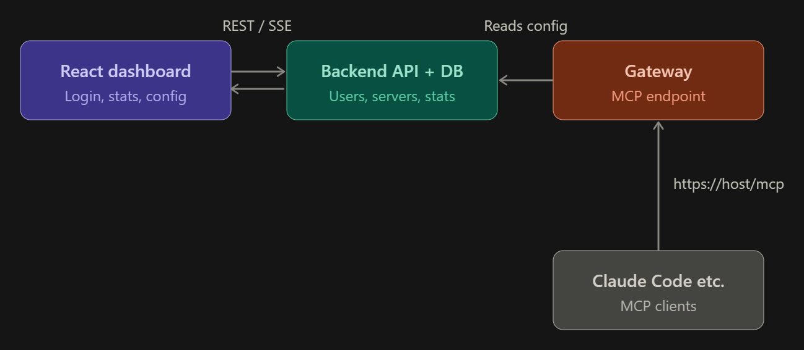

# AdaptiveGate

**An open-source, self-correcting MCP gateway with built-in governance and a web dashboard for AI agents.**

AdaptiveGate sits between an AI agent (Claude Code or any MCP-capable client) and a large library of MCP tools. Users sign in to a dashboard, configure their MCP servers and policies, and get a single router MCP link to plug into their client. The gateway then does three things in one drop-in layer:

1. **Routes**: exposes only the tools relevant to the current task, cutting token usage.
2. **Recovers**: handles tool failures automatically with configurable recovery policies.
3. **Governs**: enforces safety, privacy and compliance rules on every tool call, with a full audit trail.

> Free and open source under the MIT license, so anyone can use it as a governance harness for their own agents.

---

## Why AdaptiveGate?

Agents connected to many MCP servers run into three problems:

1. **Context bloat.** Hundreds of tool schemas consume tokens on every call, raising cost and latency and degrading tool-selection accuracy.
2. **Brittle failures.** When a tool errors, times out or returns bad output, most agents retry blindly or give up.
3. **No governance.** Agents can call destructive tools, leak secrets, fall for prompt injection hidden in tool output, or run up costs, and nothing records what they did.

Because the gateway sees every call between agent and tools, it is the natural place to fix all three without changing the agent or the tools.

## How It Works



1. A user signs in to the dashboard with GitHub (Supabase Auth).
2. They add their downstream MCP servers, choose a policy pack and generate an API key.
3. They add the router MCP link to their client:
   ```bash
   claude mcp add --transport http adaptivegate https://yourhost/mcp \
     --header "Authorization: Bearer ag_xxxxx"
   ```
4. Every tool call now flows through the gateway, which applies that user's servers and policies and records stats the dashboard displays.

## Key Features

### Routing and recovery

- Installable MCP server, works as a plugin/gateway for Claude Code and other agentic tools
- **Hybrid tool routing (ToolGate)**: keyword search (BM25) combined with semantic embeddings (pgvector), merged with reciprocal rank fusion, to expose only relevant tools and reduce token usage
- Pluggable, failure-aware recovery policies (retry, fallback tool, re-route, escalate)
- Aggregates multiple downstream MCP servers behind one endpoint

### AI governance

- **Policy-as-Code engine**: write rules in YAML and enforce them on every call, for example "no deletes outside `/project`", "max 20 tool calls per task", "require approval for GitHub writes". Ships with ready-made policy packs (safe coding agent, read-only research agent, no-PII-leaves-the-machine).
- **Human-in-the-loop approvals**: risky calls pause for approval via the dashboard or terminal. Choices: allow once, allow for session, always allow. Risk is tiered so low-risk calls never interrupt.
- **Tamper-evident audit log**: every call, argument, result, policy decision and approval goes into an append-only, hash-chained log.
- **Data protection and guardrails**:
  - detect and redact secrets, API keys and PII in tool inputs and outputs
  - scan tool outputs for prompt-injection patterns
  - tool-description integrity: pin hashes of approved tool definitions and alert when a server changes them (rug-pull defence)
- **Budgets and kill switch**: per-agent, per-tool and per-session limits on tokens, cost, call count and time, with an instant halt for runaway agents.
- **Agent identity and permissions**: scoped, least-privilege access per agent or session.
- **Dry-run and scorecard**: replay a recorded session against a new policy to see what it would block before enforcing it, and generate a report of blocked calls and policy coverage, optionally mapped to NIST AI RMF, OWASP agentic AI risks and the EU AI Act.
- **Open governance benchmark**: a runnable suite of attack scenarios (prompt injection via tool output, privilege escalation, data exfiltration, tool poisoning) that anyone can use to score their agent or gateway.

### Web dashboard (React)

- **Login**: GitHub OAuth through Supabase Auth first (Google added later), restricted to an invite allowlist during testing
- **Overview**: tokens saved, calls, success and recovery rate, and calls blocked by policy, with charts and live updates
- **Servers**: add, edit and remove downstream MCP servers (URL, auth, enabled tools) with a test-connection button
- **Policies**: choose a policy pack or edit YAML, with dry-run preview
- **Approvals**: pending risky calls waiting for allow or deny
- **Audit log**: searchable table with a hash-chain "verified" badge
- **Connect**: API key manager (keys shown once, stored hashed, revocable) and copy-paste setup snippets per client

## Measured Results

Numbers from running the real router, recovery policies and governance engine, not estimates:

| Metric | Result |
| --- | --- |
| Token reduction | **99.8%** — 22,894 → 38 tokens, over 86 real tools across 13 connected servers |
| Routing accuracy | **81%** top-1, on 16 real queries against that same live catalog |
| Attack block rate | **100%** (20/20 labeled attack scenarios) |
| False positives | **0%** (0/16 benign tasks wrongly blocked) |
| Secret detection | **100%** (6/6 secret-shaped values caught before logging) |
| Governance overhead | None measurable — every check is local and deterministic, not an LLM call |
| Recovery, worst case | **Fallback: 100%** success at a 100% downstream failure rate; retry and no-recovery both collapse to 0% |

Reproduce any of these yourself:
```bash
pnpm --filter @adaptivegate/benchmark run governance
pnpm --filter @adaptivegate/benchmark run recovery
pnpm --filter @adaptivegate/server run evaluate:live-catalog -- you@example.com
```
Results save as timestamped JSON under `experiments/`.

## Architecture

```
┌──────────────┐      ┌─────────────────────────────────────────┐      ┌────────────────┐
│  AI Agent    │ MCP  │              AdaptiveGate               │ MCP  │ MCP Server A   │
│ (Claude Code)│◄────►│                                         │◄────►│ MCP Server B   │
└──────────────┘      │  ┌──────────┐  ┌──────────┐             │      │ MCP Server C   │
                      │  │  Router  │  │ Recovery │             │      │      ...       │
                      │  └──────────┘  └──────────┘             │      └────────────────┘
                      │  ┌─────────────── Governance ─────────┐ │
                      │  │ Policy Engine │ Approvals │ Guards │ │
                      │  │ Budgets │ Identity │ Audit Log     │ │
                      │  └────────────────────────────────────┘ │
                      │  ┌──────────┐  ┌──────────┐             │
                      │  │ Registry │  │ Metrics  │             │
                      │  └──────────┘  └──────────┘             │
                      └───────────────────▲─────────────────────┘
                                          │ per-user config and events
                      ┌───────────────────┴────────────────────┐
                      │  Backend API + Supabase Postgres ◄──►  │
                      │  React dashboard                       │
                      │  (users, keys, servers, policies,      │
                      │   events, tool embeddings)             │
                      └────────────────────────────────────────┘
```

Every request flows: **API key → user lookup → policy engine → (approval if required) → router → downstream tool → output guards → audit log and event record**, with recovery policies applied on failure.

| Component         | Responsibility                                                    |
| ----------------- | ----------------------------------------------------------------- |
| Tool Registry     | Indexes tools from all connected downstream MCP servers           |
| Tool Router       | Hybrid BM25 + embedding retrieval with reciprocal rank fusion     |
| Recovery Policies | Decides what to do when a tool call fails                         |
| Policy Engine     | Evaluates allow / deny / require-approval rules per call          |
| Approvals         | Human-in-the-loop prompts across dashboard, terminal and chat     |
| Guards            | Secret/PII redaction, injection scanning, tool-definition pinning |
| Budgets           | Token, cost, call-count and time limits, kill switch              |
| Identity          | Scoped permissions per agent or session, API key lookup           |
| Audit Log         | Hash-chained, tamper-evident record of everything                 |
| Metrics           | Token usage, latency, accuracy, recovery and governance outcomes  |
| Backend API       | Users, keys, server configs, policies and stats for the dashboard |
| Dashboard         | React UI for login, stats and configuration                       |

### Security notes for the hosted version

- **Remote servers only.** Hosted mode accepts remote HTTP/SSE MCP servers. Accepting stdio commands such as `npx some-server` would let users run arbitrary commands on the host, so stdio is reserved for a locally run gateway.
- **Credentials are encrypted at rest** with a server-side key and never returned to the browser.
- **API keys are stored hashed**, shown once and revocable.
- **Strict tenant isolation.** Every query is scoped by user ID; one user's config must never be reachable with another user's key. Supabase row-level security is enabled as a second layer.
- **Invite-only access.** Sign-in is limited to an email allowlist during testing.
- **Per-user rate limits** on the MCP endpoint, the API and embedding calls, so a bug or runaway agent cannot exhaust hosting or API budget.
- **Outbound URL validation** for downstream servers (block localhost, private IP ranges and cloud metadata addresses) to prevent SSRF.

## Tech Stack

| Area            | Choice                                                                            |
| --------------- | --------------------------------------------------------------------------------- |
| Language        | TypeScript everywhere (gateway, backend, dashboard, shared types)                 |
| Monorepo        | pnpm workspaces                                                                   |
| Gateway and API | Node.js with Hono or Fastify, official MCP TypeScript SDK (Streamable HTTP)       |
| Dashboard       | Vite, React, Tailwind CSS, shadcn/ui, TanStack Query, Recharts                    |
| Shared schemas  | Zod (one definition used by gateway, API and dashboard)                           |
| Database        | Supabase Postgres with Drizzle ORM, row-level security, pgvector for embeddings   |
| Auth            | Supabase Auth (GitHub OAuth, or email/password) — cloud or self-hosted            |
| Routing         | MiniSearch (BM25) + embeddings via pgvector, merged with reciprocal rank fusion   |
| Live updates    | Server-sent events                                                                |
| Testing         | Vitest, Playwright                                                                |
| Deployment      | Containerized server on Render, Railway or Fly.io; dashboard on Vercel or Netlify |

## Getting Started

### Prerequisites

- Node.js 20+ and pnpm
- A Supabase project (database and auth) — **or** skip the cloud account and run everything
  locally instead; see [docs/self-hosting.md](docs/self-hosting.md)
- An MCP-compatible client (e.g. Claude Code)

### Installation

```bash
git clone https://github.com/Balaji-R-05/adaptivegate.git
cd adaptivegate
pnpm install
cp .env.example .env     # Supabase URL and keys, encryption key, embedding API key
pnpm db:migrate
```

### Running locally

```bash
pnpm dev                 # runs server (API + /mcp gateway) and dashboard together
```

### Configuration

Self-hosted users can also configure everything from files. Downstream servers and recovery in `config.yaml`:

```yaml
servers:
  - name: github
    url: https://example.com/github-mcp
    auth: { type: bearer, token_env: GITHUB_MCP_TOKEN }
  - name: docs
    url: https://example.com/docs-mcp

router:
  mode: hybrid # bm25 | embedding | hybrid
  top_k: 8

recovery:
  policy: fallback # retry | fallback | reroute | escalate
  max_attempts: 3
```

Governance rules in `policies/my-policy.yaml`:

```yaml
version: 1
agent: default
budgets:
  max_calls_per_task: 20
  max_cost_usd: 2.00
rules:
  - name: no-delete-outside-project
    match: { tool: 'filesystem.delete_*' }
    when: { path_not_under: './project' }
    action: deny
  - name: approve-github-writes
    match: { tool: 'github.create_*' }
    action: require_approval
  - name: redact-secrets
    match: { direction: both }
    action: redact
    detectors: [api_key, aws_key, email, phone]
```

### Use with Claude Code

Hosted or self-hosted, with a key generated from the dashboard's Connect page:

```bash
claude mcp add --transport http adaptivegate https://yourhost/mcp \
  --header "Authorization: Bearer ag_xxxxx"
```

### Dry-run a policy against a recorded session

```bash
pnpm replay --log logs/session.jsonl --policy policies/strict.yaml
```

## Project Structure

```
adaptivegate/
├── apps/
│   ├── dashboard/       # React + Vite frontend
│   └── server/          # Hono/Fastify: /mcp gateway + REST/SSE API
├── packages/
│   ├── core/            # router, recovery, governance
│   │   ├── router/      # hybrid ToolGate (BM25 + embeddings + RRF)
│   │   ├── recovery/    # recovery policies
│   │   └── governance/  # policy, approvals, guards, budgets, identity, audit
│   ├── db/              # Drizzle schema and migrations
│   └── shared/          # Zod schemas and shared types
├── benchmark/           # governance attack scenarios and failure injection
├── experiments/         # saved configs, seeds and results
├── policies/            # policy packs
├── docs/
├── config.yaml
├── .env.example
├── LICENSE
├── CLAUDE.md
└── README.md
```

## License

[MIT](LICENSE)
